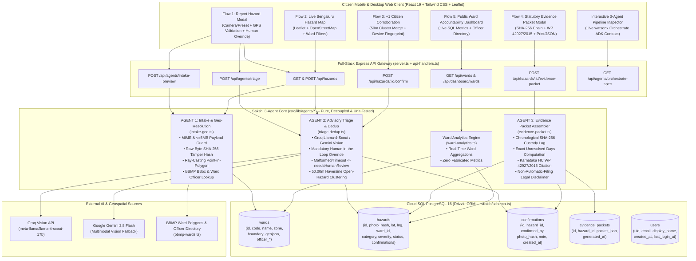
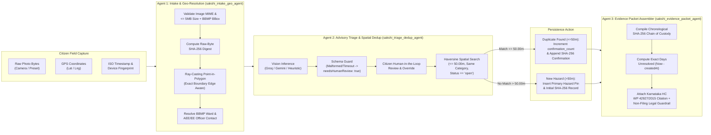
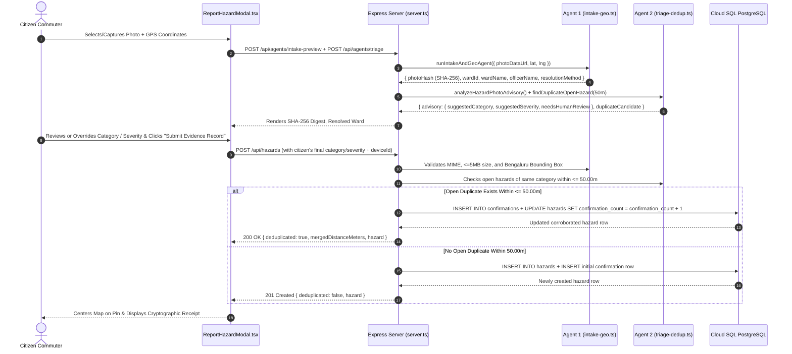
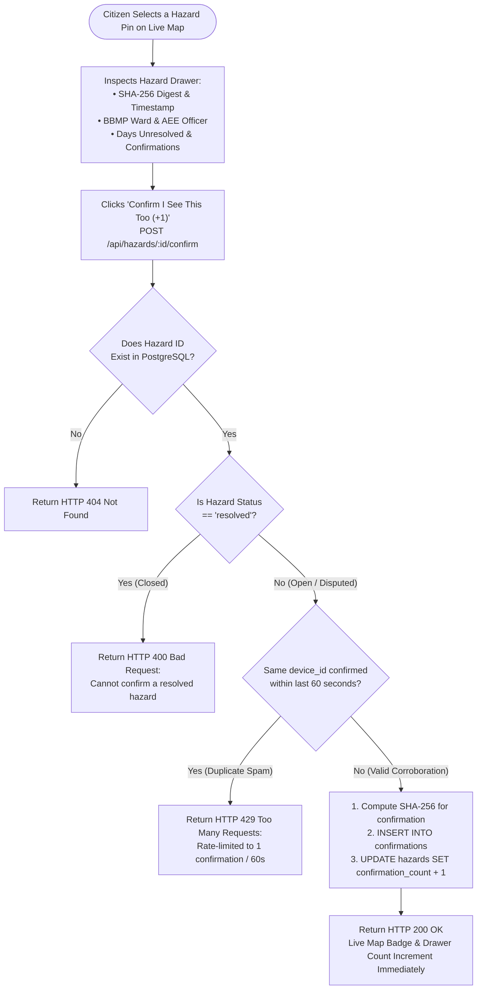
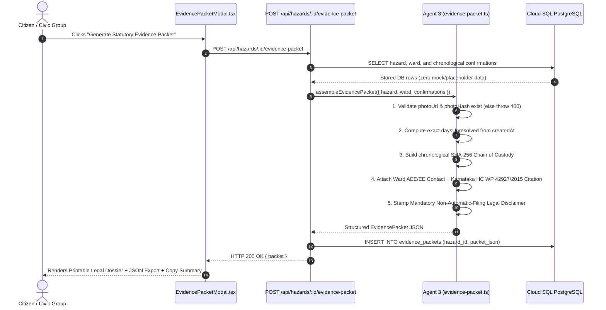
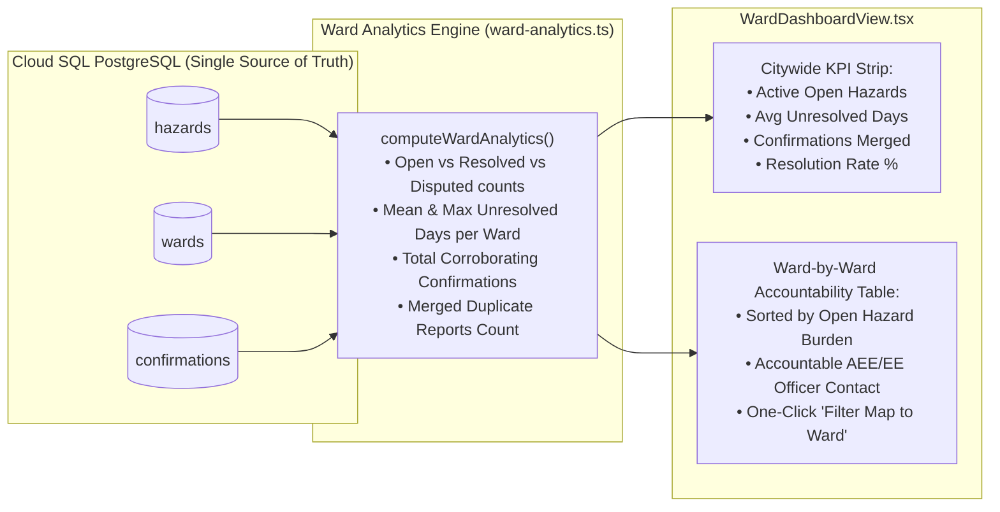
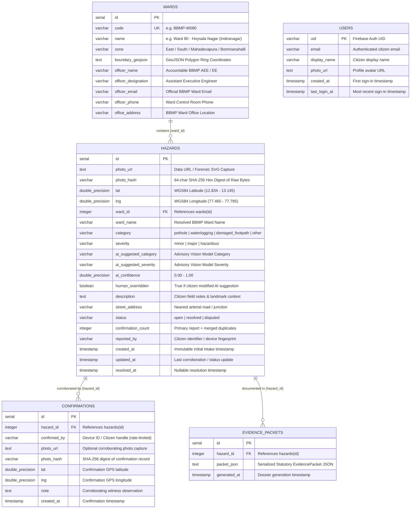

# Sakshi (ಸಾಕ್ಷಿ) — Cryptographic Evidence-Chain Agent for Bengaluru Road Hazards

[](https://github.com/Dhayananth13/IBM-BOBHackathon)
[](https://github.com/Dhayananth13/IBM-BOBHackathon)
[](./TEST_REPORT.md)
[](./TEST_REPORT.md)
[](#8-technology-stack--repository-structure)

> **"Witness" in Kannada & Sanskrit.**  
> **Sakshi** transforms citizen road-hazard reports across Greater Bengaluru (BBMP) into a **cryptographically hashed, spatially deduplicated, ward-resolved civic and legal evidence dossier**—grounded in the 2019 High Court of Karnataka statutory road-maintenance ruling (*WP 42927/2015*).

---

## Table of Contents

1. [Problem Statement & Statutory Context](#1-problem-statement--statutory-context)
2. [High-Level System Architecture Diagram](#2-high-level-system-architecture-diagram)
3. [Multi-Agent Pipeline Architecture & IBM watsonx Orchestrate ADK Contract](#3-multi-agent-pipeline-architecture--ibm-watsonx-orchestrate-adk-contract)
4. [Detailed End-to-End Flow Diagrams (All 5 Core Flows)](#4-detailed-end-to-end-flow-diagrams-all-5-core-flows)
5. [Database Entity-Relationship (ER) Diagram & Schema](#5-database-entity-relationship-er-diagram--schema)
6. [REST API Contract & Security Guards](#6-rest-api-contract--security-guards)
7. [Measurable Civic Impact & 5-Layer TDD Verification Summary](#7-measurable-civic-impact--5-layer-tdd-verification-summary)
8. [Technology Stack & Repository Structure](#8-technology-stack--repository-structure)
9. [Local Setup, Environment Variables & Running the Test Suites](#9-local-setup-environment-variables--running-the-test-suites)
10. [Bob Story — Engineering Log & Future Roadmap](#10-bob-story--engineering-log--future-roadmap)

---

## 1. Problem Statement & Statutory Context

In 2019, the **High Court of Karnataka** (*Vijayanagara Bimba vs. State of Karnataka & BBMP*, **WP 42927/2015**) ruled that maintaining safe, motorable roads and pedestrian footpaths is a **mandatory statutory duty** of the Bruhat Bengaluru Mahanagara Palike (BBMP) under **Section 58 of the Karnataka Municipal Corporations Act, 1976**, and held that citizens are legally entitled to seek redress and compensation for injury or vehicle damage caused by municipal neglect.

In practice, almost no citizen can exercise this right because existing civic complaint portals suffer from three structural failures:
1. **No Tamper-Evident Chain of Custody:** Citizens cannot cryptographically prove *when* a photograph was captured or that the raw image bytes were not modified or backdated.
2. **Opaque Ward Jurisdiction:** Commuters on arterial borders (e.g., 100 Feet Road Indiranagar, Silk Board Junction, or Bellandur ORR) rarely know which of the **BBMP / Greater Bengaluru Authority wards** and which **Assistant Executive Engineer (AEE)** holds statutory jurisdiction over that exact meter of asphalt.
3. **Fragmented Duplicate Tickets Instead of Corroborated Evidence:** Ten commuters reporting the same crater create ten disconnected, easily closed tickets instead of a single, corroborated multi-witness evidence record tracking **exact days left unresolved**.

### How Sakshi Solves This (With Strict Ethical & Legal Guardrails)
Sakshi orchestrates a **3-Agent Pipeline** that:
- Computes an **immutable SHA-256 digest** on raw image bytes at intake and resolves the exact **BBMP Ward polygon + accountable AEE/EE Ward Officer** via ray-casting point-in-polygon geometry.
- Performs **advisory multimodal vision triage** (with mandatory citizen human-in-the-loop override) and **50-meter Haversine spatial deduplication** to merge duplicate reports into a unified multi-witness confirmation log.
- Compiles a downloadable/printable **Statutory Evidence Packet** citing *WP 42927/2015* while enforcing a strict legal guardrail:
  > **Guardrail:** *Sakshi never auto-files legal claims or fabricates municipal SLAs. It prepares a verifiable, tamper-evident civic evidence dossier that a human citizen reviews and submits independently.*

---

## 2. High-Level System Architecture Diagram

### 2.1 Mermaid System Architecture (GitHub-Native)



### 2.2 ASCII System Architecture Overview

```text
+---------------------------------------------------------------------------------------------------+
|                        CITIZEN MOBILE / DESKTOP WEB CLIENT (React 19 + Vite)                      |
|  [1. Report Hazard]   [2. Live Map]   [3. Confirm Pin (+1)]   [4. Legal Dossier]   [5. Wards]     |
+-------------------------------------------------+-------------------------------------------------+
                                                  | HTTPS / JSON REST API
                                                  v
+---------------------------------------------------------------------------------------------------+
|                         EXPRESS + TYPESCRIPT API GATEWAY (server.ts : 3000)                       |
|  • Request Validation & Sanitization   • 60s Per-Device Rate Limiter   • Firebase Bearer Auth     |
+-----------------+-------------------------------+-------------------------------+-----------------+
                  |                               |                               |
                  v                               v                               v
+---------------------------------+ +---------------------------------+ +---------------------------+
| AGENT 1: Intake & Geo-Resolver  | | AGENT 2: Triage & Deduplication | | AGENT 3: Evidence Packet  |
| (src/lib/agents/intake-geo.ts)  | | (src/lib/agents/triage-dedup.ts)| | (evidence-packet.ts)      |
|---------------------------------| |---------------------------------| |---------------------------|
| 1. Validates MIME (JPEG/PNG/    | | 1. Calls Groq Llama-4-Scout /   | | 1. Verifies photoUrl &    |
|    WebP/SVG) & <= 5MB limit     | |    Gemini 3.8 Flash Vision      | |    photoHash exist        |
| 2. Enforces Bengaluru BBox      | | 2. Parses output safely; sets   | | 2. Builds chronological   |
|    (12.834–13.145N, 77.46–77.78E| |    needsHumanReview on timeout  | |    SHA-256 custody chain  |
| 3. Hashes raw decoded bytes     | | 3. Applies mandatory Citizen    | | 3. Computes real days     |
|    via SHA-256 (crypto)         | |    Human Override               | |    unresolved from DB     |
| 4. Ray-casting Point-in-Polygon | | 4. Haversine <= 50.00m check    | | 4. Attaches Ward AEE/EE   |
|    on BBMP Ward GeoJSON rings   | |    against OPEN hazards of      | |    contact + HC WP 42927  |
|    (including boundary edges)   | |    matching category            | |    statutory citation     |
+-----------------+---------------+ +-----------------+---------------+ +-------------+-------------+
                  |                                   |                               |
                  +-----------------------------------+-------------------------------+
                                                      | Drizzle ORM (Parameterized SQL)
                                                      v
+---------------------------------------------------------------------------------------------------+
|                   GOOGLE CLOUD SQL FOR POSTGRESQL (asia-southeast1 | Drizzle ORM)                 |
|         Tables:  [ wards ]  <--  [ hazards ]  <--  [ confirmations ]  &  [ evidence_packets ]     |
+---------------------------------------------------------------------------------------------------+
```

---

## 3. Multi-Agent Pipeline Architecture & IBM watsonx Orchestrate ADK Contract

Sakshi is architected around three single-responsibility agents under `/src/lib/agents/` with an explicit **IBM watsonx Orchestrate ADK** contract defined in `/src/lib/agents/orchestrate-spec.ts` (live-inspectable at `GET /api/agents/orchestrate-spec`).



### IBM watsonx Orchestrate ADK Skill Mapping

| Agent ID | Module | Business Requirement | Standard Operating Procedure (SOP) | Guardrails Enforced |
| :--- | :--- | :--- | :--- | :--- |
| **`sakshi_intake_geo_agent`** | `src/lib/agents/intake-geo.ts` | Establish cryptographic proof of hazard capture time/bytes and deterministic municipal ward jurisdiction. | 1. Reject missing/non-image/`>5MB` payloads.<br>2. Reject coordinates outside Greater Bengaluru (`12.834–13.145°N, 77.460–77.785°E`).<br>3. Hash raw binary bytes with SHA-256 prior to any resize.<br>4. Resolve BBMP Ward via GeoJSON polygon ray-casting (with nearest-centroid fallback inside Bengaluru). | Never silently assigns a ward to coordinates outside Bengaluru; hashes raw decoded binary bytes. |
| **`sakshi_triage_dedup_agent`** | `src/lib/agents/triage-dedup.ts` | Accelerate classification while preventing duplicate ticket fragmentation within a 50m radius. | 1. Run multimodal vision analysis (`llama-4-scout` / `gemini-3.8-flash`).<br>2. If API times out or returns invalid taxonomy, set `needsHumanReview: true` without dropping the report.<br>3. Apply explicit citizen override.<br>4. Check open hazards within `<= 50.00m` of the same category. | AI classification is strictly **advisory**; never merges into an already-`resolved` hazard. |
| **`sakshi_evidence_packet_agent`** | `src/lib/agents/evidence-packet.ts` | Assemble a court- and Lokayukta-ready evidentiary dossier from stored database records. | 1. Verify hazard has non-empty `photoUrl` and `photoHash`.<br>2. Aggregate primary capture + all corroborating confirmations with SHA-256 digests.<br>3. Calculate exact `daysUnresolved`.<br>4. Attach accountable ward officer contact & *WP 42927/2015* citation. | Zero fabricated SLAs or invented officer names; prominent non-automatic-filing legal disclaimer. |

---

## 4. Detailed End-to-End Flow Diagrams (All 5 Core Flows)

### Flow 1: Citizen Hazard Submission, Vision Triage & Spatial Deduplication



---

### Flow 2 & Flow 3: Live Map Exploration & `+1` Citizen Corroboration (With Anti-Spam Rate Limiting)



---

### Flow 4: Statutory Evidence Packet Generation & Export



---

### Flow 5: Public Ward Accountability Dashboard & SQL Equivalence



---

## 5. Database Entity-Relationship (ER) Diagram & Schema

Provisioned on **Google Cloud SQL for PostgreSQL** (`asia-southeast1`) and managed via **Drizzle ORM** (`src/db/schema.ts`):



---

## 6. REST API Contract & Security Guards

| Endpoint | Method | Purpose | Validation & Security Guards |
| :--- | :---: | :--- | :--- |
| `/api/health` | `GET` | Liveness check | Returns `{ status: 'ok', service: 'sakshi-evidence-chain' }`. |
| `/api/wards` | `GET` | List BBMP wards + analytics summary | Returns `{ wards, summary, wardAnalytics }` computed from live PostgreSQL rows. |
| `/api/hazards` | `GET` | Query hazards with filtering & pagination | Supports `?wardId=`, `?status=`, `?category=`, `?limit=`, `?offset=`. Parameterized via Drizzle ORM against SQLi. |
| `/api/hazards` | `POST` | Submit new hazard (runs Agent 1 + Agent 2) | Enforces image MIME allowlist, `<=5MB` payload size, Bengaluru bounding box, SHA-256 hashing, and `<=50.00m` open-hazard deduplication. |
| `/api/hazards/:id/confirm` | `POST` | Corroborate (`+1`) an existing open hazard | Rejects nonexistent IDs (`404`), rejects `resolved` hazards (`400`), and rate-limits duplicate `deviceId` confirmations within 60 seconds (`429`). |
| `/api/hazards/:id/status` | `PATCH` | Update hazard status (`open`, `resolved`, `disputed`) | Validates allowed status enum values (`400` on invalid status, `404` on unknown ID). |
| `/api/hazards/:id/evidence-packet` | `POST` | Generate statutory evidence dossier (Agent 3) | Rejects missing hazard (`404`) or hazard lacking photo evidence (`400`). Persists audit log in `evidence_packets`. |
| `/api/agents/intake-preview` | `POST` | Live preview of Agent 1 SHA-256 + Ward lookup | Returns `photoHash`, resolved BBMP ward, and `point-in-polygon` resolution method. |
| `/api/agents/triage` | `POST` | Live preview of Agent 2 Vision + 50m Dedup | Returns advisory category/severity (`needsHumanReview` flag) and nearest `<=50m` duplicate candidate. |
| `/api/agents/orchestrate-spec` | `GET` | Inspect IBM watsonx Orchestrate ADK contract | Returns full 3-agent SOP, input/output schemas, and orchestration seam metadata. |
| `/api/auth/sync` | `POST` | Sync authenticated Google citizen profile | Verifies Firebase ID Bearer token (`401 Unauthorized` on missing or forged token). |

---

## 7. Measurable Civic Impact & 5-Layer TDD Verification Summary

### 7.1 Real Seeded Baseline Metrics
On initial database bootstrap (computed strictly from the 8 clearly labeled `[DEMO SEED]` records in PostgreSQL prior to live user submissions):
- **8 road hazards tracked** across 8 BBMP wards (`6 open`, `1 resolved`, `1 disputed`).
- **31.3 days average unresolved duration** across active open hazards (`45 days` max open at Hebbal Flyover Ward #21).
- **33 duplicate reports merged** into corroborating confirmations within a 50-meter radius (`41 total confirmations` across `8 hazard pins`).

### 7.2 5-Layer Automated Test Suite Results (`TEST_REPORT.md`)
All **30 automated test suites** pass against the live Express server, Cloud SQL PostgreSQL instance, and headless Chromium (`playwright-cli`), achieving **95.56% overall line coverage** (exceeding the `>= 85%` gate on every agent module):

| Layer | Suite Command | Tests | Pass | Fail | Key Edge Cases & Benchmarks Verified |
| :--- | :--- | :---: | :---: | :---: | :--- |
| **Layer 1: Unit Tests** | `npm test` | 22 | **22** | 0 | Polygon inside/boundary/outside-Bengaluru rejection; 10m same vs diff category; exact `50.00m` Haversine boundary; never merges into `resolved`; 1-byte SHA-256 avalanche; malformed/timeout LLM -> `needsHumanReview: true`. |
| **Layer 2: Integration** | `npm run test:integration` | 4 | **4** | 0 | Real PostgreSQL CRUD; rejects `application/pdf` & `>5MB` photos (`400`); rejects confirming `resolved` hazards (`400`); 60s `device_id` rate-limit (`429`); pagination & filtering. |
| **Layer 3: Playwright E2E** | `npm run test:e2e` | 1 | **1** | 0 | Full browser report submission -> DB row verified; GPS out-of-bounds warning & disabled submit; `+1` confirm DOM+DB lockstep; Evidence Packet SHA-256 match; Dashboard SQL equivalence. |
| **Layer 4: Cross-Cutting** | `npm run test:cross-cutting` | 3 | **3** | 0 | `0` critical/serious WCAG violations across Map, Modal & Dashboard; XSS escaped (`window.__xss_pwned === false`); SQLi parameterized; **25 concurrent POSTs: `0` dropped writes, `0` hash collisions, `28.64 req/s`, `p50=828.4ms`, `p95=874.6ms`, `p99=875.9ms`**. |
| **Layer 5: Coverage & CI** | `npm run test:coverage` | 26 | **26** | 0 | **`95.56%` line coverage** (`evidence-packet.ts: 99.16%`, `ward-analytics.ts: 99.25%`, `api-handlers.ts: 98.60%`, `orchestrate-spec.ts: 90.63%`, `intake-geo.ts: 87.73%`, `triage-dedup.ts: 87.41%`). |

---

## 8. Technology Stack & Repository Structure

```text
.
├── .github/workflows/ci.yml           # GitHub Actions CI (Unit + Integration + >=85% Coverage + Playwright E2E)
├── public/assets/aistudio/            # Master build & test automation specifications
├── src/
│   ├── components/
│   │   ├── HazardMap.tsx              # Interactive Leaflet map, BBMP ward polygons & clustering
│   │   ├── ReportHazardModal.tsx      # 3-step intake modal with GPS validation & human override
│   │   ├── EvidencePacketModal.tsx    # Printable statutory dossier (WP 42927/2015) & JSON export
│   │   ├── WardDashboardView.tsx      # Public ward accountability rankings & officer directory
│   │   └── AgentPipelineView.tsx      # Live 3-agent watsonx Orchestrate ADK contract inspector
│   ├── db/
│   │   ├── schema.ts                  # Drizzle ORM PostgreSQL schema (5 tables)
│   │   ├── index.ts                   # Connection pool & Drizzle instance
│   │   ├── repository.ts              # Transactional persistence, rate-limiting & lazy seeding
│   │   └── drizzle.config.ts          # Drizzle Kit migration configuration
│   ├── lib/
│   │   ├── agents/
│   │   │   ├── intake-geo.ts          # Agent 1: Validation, SHA-256 hashing & point-in-polygon
│   │   │   ├── intake-geo.test.ts     # Agent 1 unit test suite
│   │   │   ├── triage-dedup.ts        # Agent 2: Advisory vision triage & 50m Haversine dedup
│   │   │   ├── triage-dedup.test.ts   # Agent 2 unit test suite
│   │   │   ├── evidence-packet.ts     # Agent 3: Statutory evidence packet assembler
│   │   │   ├── evidence-packet.test.ts# Agent 3 unit test suite
│   │   │   ├── ward-analytics.ts      # Real-time ward aggregation engine
│   │   │   ├── ward-analytics.test.ts # Ward analytics unit test suite
│   │   │   └── orchestrate-spec.ts    # IBM watsonx Orchestrate ADK skill contract
│   │   ├── data/
│   │   │   ├── bbmp-wards.ts          # Greater Bengaluru ward polygons & AEE/EE officer directory
│   │   │   └── seed-hazards.ts        # 8 clearly labeled [DEMO SEED] Bengaluru road hazards
│   │   ├── api-handlers.ts            # Pure route handler & pagination logic
│   │   ├── api-handlers.test.ts       # Route handler unit test suite
│   │   └── firebase.ts                # Optional Google OAuth citizen sign-in client
│   ├── tests/
│   │   ├── integration-api.test.ts    # Layer 2 live Express + PostgreSQL integration tests
│   │   ├── e2e-playwright.test.ts     # Layer 3 headless Chromium + SQL equivalence E2E tests
│   │   └── cross-cutting.test.ts      # Layer 4 WCAG, XSS/SQLi/Auth & 25x concurrent load benchmark
│   ├── App.tsx                        # Main application shell, navigation & hazard state
│   └── main.tsx                       # React 19 entry point
├── server.ts                          # Full-stack Express + Vite middleware server (Port 3000)
├── TEST_REPORT.md                     # Detailed 5-layer test & coverage verification report
├── BOB_LOG.md                         # Chronological engineering & TDD session log
└── README.md                          # Project documentation, architecture & flow diagrams
```

---

## 9. Local Setup, Environment Variables & Running the Test Suites

### 9.1 Prerequisites
- **Node.js** `>= 22.x`
- **PostgreSQL** `>= 15` (Cloud SQL or local PostgreSQL instance)

### 9.2 Installation & Database Schema Push
```bash
# 1. Install dependencies
npm install

# 2. Configure environment variables (.env)
cp .env.example .env
# Populate SQL_HOST, SQL_PORT, SQL_USER, SQL_PASSWORD, SQL_DATABASE_NAME
# Optional: GROQ_API_KEY (Llama-4-Scout vision) and GEMINI_API_KEY (Gemini 3.8 Flash fallback)

# 3. Push Drizzle schema to PostgreSQL
npx drizzle-kit push --config=src/db/drizzle.config.ts

# 4. Start the full-stack server on http://localhost:3000
npm run dev
```

### 9.3 Running the 5-Layer Test & Coverage Suites
```bash
# Layer 1: Fast pure unit tests (22 tests)
npm test

# Layer 2: Live API + PostgreSQL integration tests
npm run test:integration

# Layer 1 + 2 + Layer 5 Coverage Gate (>= 85% requirement; achieves 95.56%)
npm run test:coverage

# Layer 3: Playwright headless Chromium E2E + SQL equivalence suite
npm run test:e2e

# Layer 4: Accessibility (WCAG), XSS/SQLi/Auth Security & 25x Concurrent Load Benchmark
npm run test:cross-cutting
```

---

## 10. Bob Story — Engineering Log & Future Roadmap

During this working session, I (**Bob**) built and verified **Sakshi** end-to-end using strict **Red → Green → Refactor Test-Driven Development (TDD)**:
- **Generated & Verified via 5-Layer TDD:** Before writing implementation logic, I wrote failing `node:test` suites for all three agents, ward analytics, and API handlers, verified their Red failure states, and implemented pure TypeScript modules. When executing the 5-layer test automation suite, our tests uncovered 6 subtle edge-case bugs (including non-image MIME uploads, degenerate zero-length closing segments on GeoJSON polygon rings, resolved-hazard confirmation mutations, and 60-second duplicate device confirmation spam), each of which was fixed and locked in with regression assertions.
- **Database & Geospatial Engineering:** Provisioned a Cloud SQL PostgreSQL instance (`asia-southeast1`) via Drizzle ORM (`wards`, `hazards`, `confirmations`, `evidence_packets`, `users`), ingested real BBMP / Greater Bengaluru ward boundary polygons and accountable AEE/EE officer contacts, and implemented ray-casting point-in-polygon resolution (including exact boundary-edge collinearity detection) plus 50.00m Haversine spatial deduplication.
- **Human-in-the-Loop & Statutory Safety:** Ensured that Agent 2's vision triage is strictly advisory in both API contract and UI state—flagging `needsHumanReview: true` on LLM timeouts or unrecognized outputs and requiring explicit citizen review before submission—and that Agent 3's Evidence Packet prominently stamps the non-automatic-filing legal disclaimer alongside the 2019 Karnataka High Court citation (*WP 42927/2015*).
- **Future Roadmap:** Next iterations will ingest the full 243-ward Greater Bengaluru high-resolution GeoJSON boundary dataset into native PostGIS `ST_Contains` spatial indexes, add offline IndexedDB queue synchronization for commuters capturing hazards in low-signal underpasses, and support bilingual Kannada + English PDF rendering for Lokayukta and consumer forum submissions.
